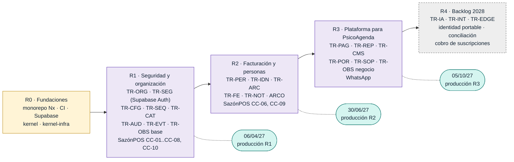
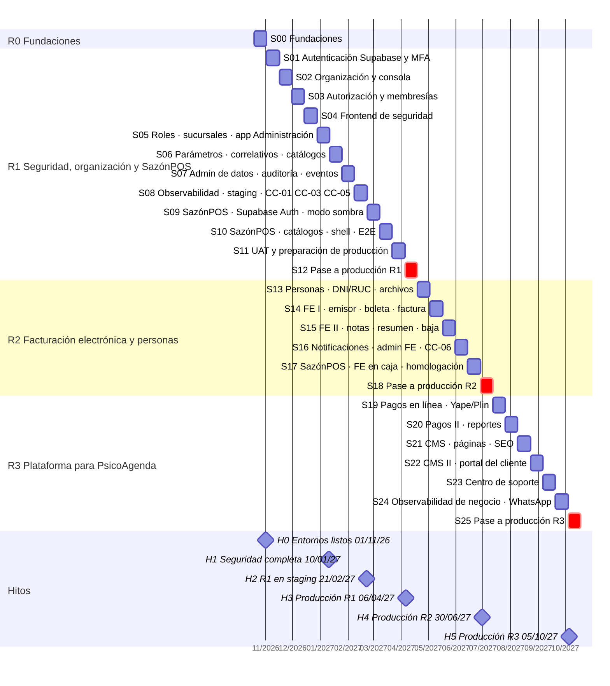
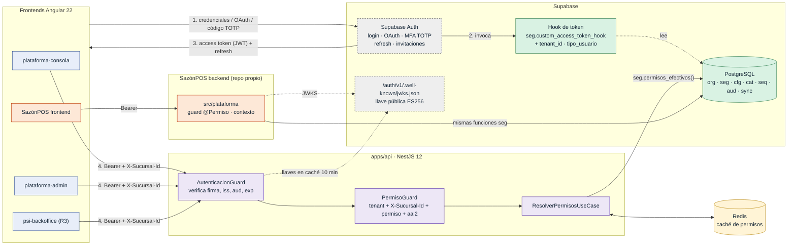
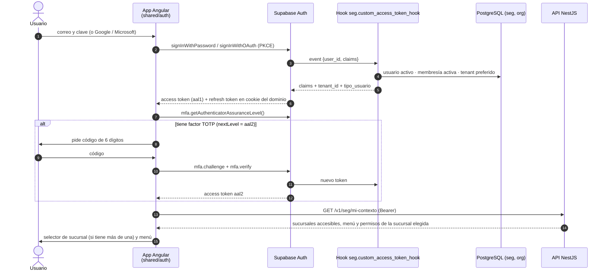
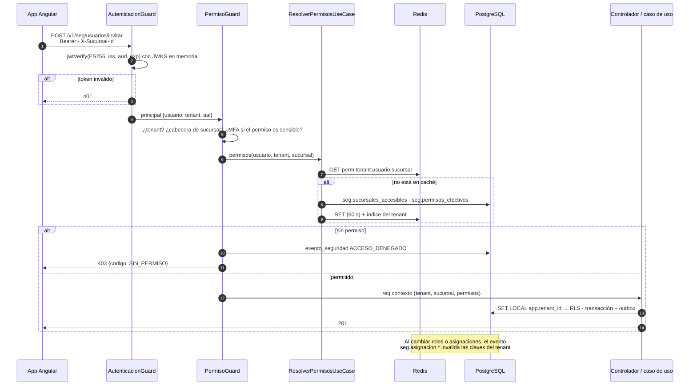
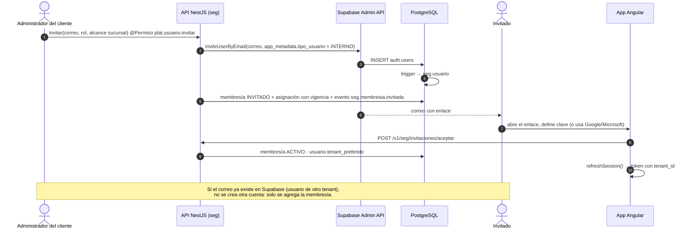
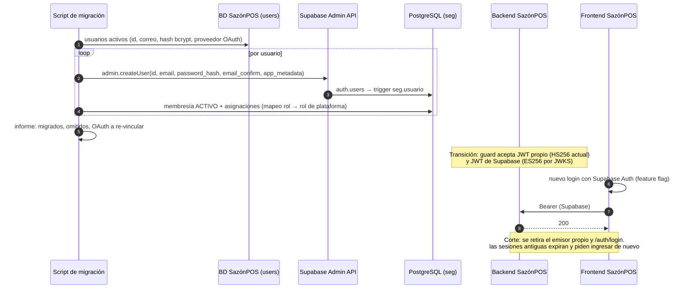
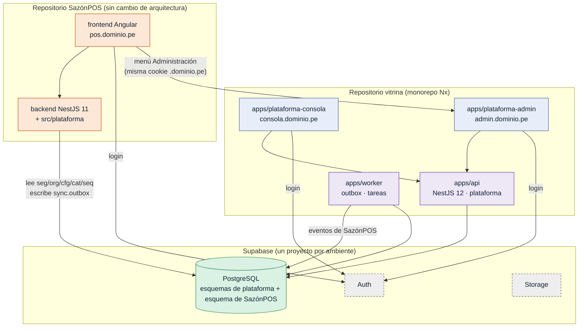
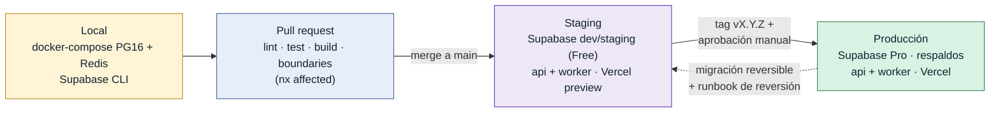
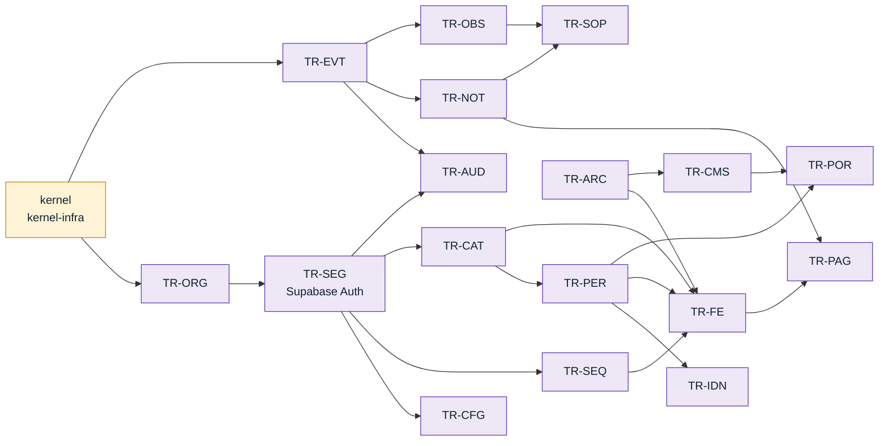

# Plan de implementación de la plataforma transversal

## PL-01 — Hoja de ruta de releases

Cada release termina en producción con un consumidor real. R1 pone a SazónPOS sobre la seguridad y los datos de referencia de la plataforma; R2 agrega facturación electrónica para que SazónPOS sea vendible; R3 deja lista la plataforma para PsicoAgenda; R4 queda como backlog priorizable.

## PL-02 — Cronograma de sprints e hitos

Sprints de dos semanas desde el 19/10/26, con 11 horas por semana. Los sprints de fin de año y Semana Santa tienen capacidad reducida. En rojo, los sprints de pase a producción.

## PL-03 — Autenticación con Supabase Auth y autorización propia

Supabase Auth autentica (correo y clave, Google, Microsoft, MFA TOTP) y emite un JWT firmado con llave asimétrica. El hook agrega el tenant activo. La API NestJS verifica la firma con el JWKS público, sin llamar a Supabase en cada solicitud, y autoriza con los permisos efectivos de seg por sucursal, guardados en Redis. SazónPOS lee las mismas tablas de la plataforma.

## PL-04 — Secuencia: ingreso con MFA y token con tenant activo

El segundo factor se pide solo si el usuario lo tiene enrolado; para administradores de plataforma y permisos sensibles es obligatorio. El token que sale de Supabase ya trae el tenant activo; los permisos no viajan en el token.

## PL-05 — Secuencia: solicitud autorizada en la API

Dos guards globales. El primero valida el token localmente con el JWKS. El segundo exige tenant, sucursal asignada, el permiso del endpoint y, si el permiso es sensible, una sesión aal2. Las denegaciones se registran en seg.evento_seguridad.

## PL-06 — Secuencia: invitación de un usuario al tenant

La invitación la crea el backend con la Admin API de Supabase (secret key solo en el servidor). El trigger sobre auth.users crea seg.usuario; la membresía nace INVITADO y pasa a ACTIVO cuando el invitado acepta.

## PL-07 — Secuencia: migración de usuarios de SazónPOS a Supabase Auth (CC-10)

Se conservan los UUID y los hash bcrypt, así que nadie cambia de clave. Durante la transición el backend de SazónPOS acepta su token actual y el de Supabase; el corte retira el emisor antiguo.

## PL-08 — Integración de SazónPOS con la plataforma

SazónPOS no cambia de repositorio ni de arquitectura. Comparte el proyecto Supabase (Auth y base de datos), lee las tablas de plataforma con su módulo src/plataforma y abre la app de Administración para usuarios, roles y parámetros. La cookie en el dominio padre evita volver a ingresar.

## PL-09 — Ambientes y flujo de entrega

Tres ambientes con un proyecto Supabase cada uno. Cada cambio pasa por pull request y CI con nx affected; staging se despliega al integrar a main y producción con una etiqueta de versión y aprobación manual.

## PL-10 — Dependencias entre componentes transversales

Orden de construcción. Nada se construye antes que aquello de lo que depende; por eso seguridad y organización van primero y la facturación electrónica espera a personas, correlativos y catálogos.

