# Plataforma de Operación · Diagramas Mermaid

## OP-01 — Mapa de la plataforma de operación

Los tres componentes se apoyan en los cimientos transversales ya definidos (organización, seguridad, eventos) y se conectan entre sí: una alerta de observabilidad abre un ticket, el ticket trae su traza, y el servicio de identidad sirve a los nueve productos. Los recuadros punteados son piezas existentes que se usan, no se construyen.

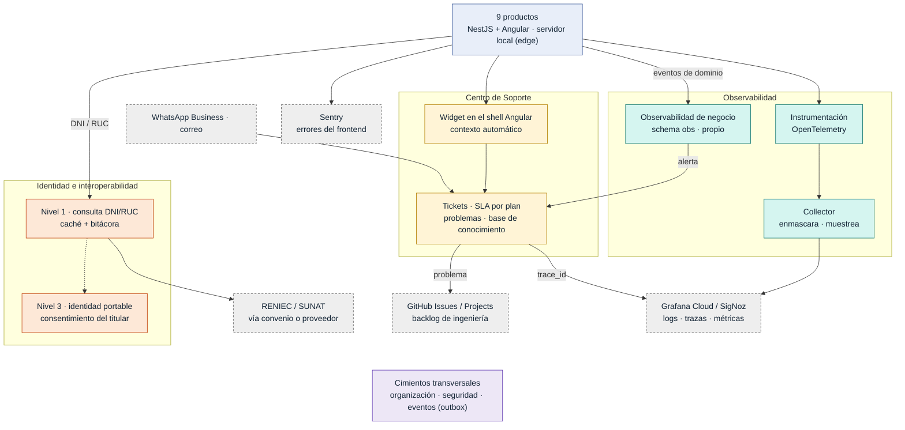

## OP-02 — Arquitectura de observabilidad: comprar el motor, construir la capa de negocio

La telemetría técnica sigue el estándar OpenTelemetry y termina en un backend existente (intercambiable). La observabilidad de negocio reutiliza los eventos de dominio del outbox: un consumidor los agrega por minuto en el schema obs, un evaluador aplica reglas y las alertas llegan al Centro de Soporte y a WhatsApp.

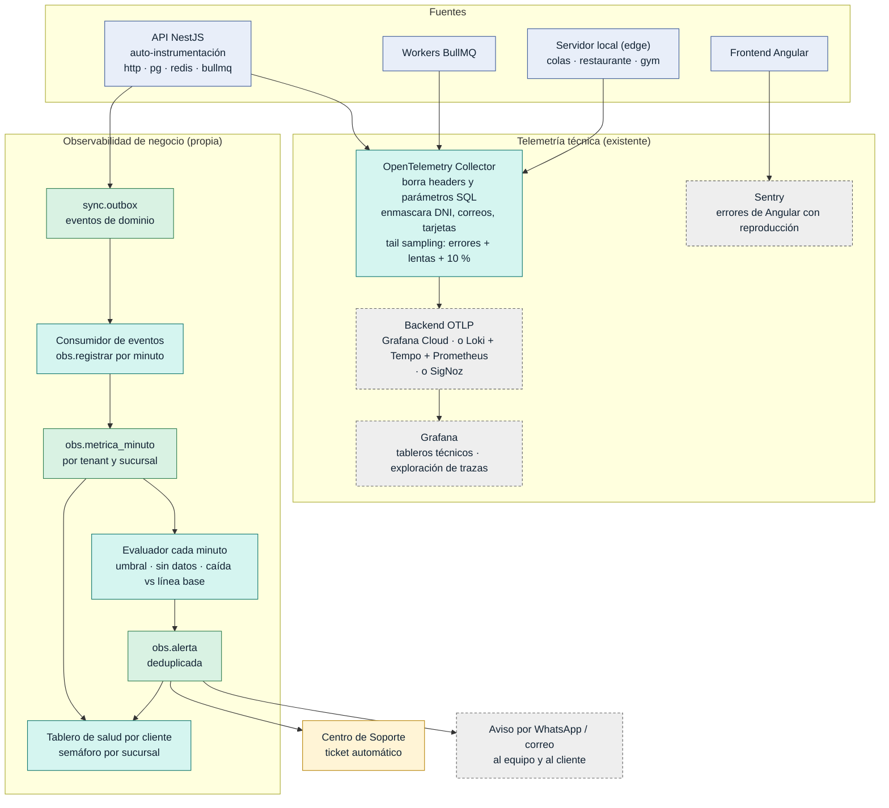

## OP-03 — Secuencia: de la caída de pedidos al ticket con su traza

Ejemplo de punta a punta: la sucursal Miraflores deja de registrar pedidos a las 13:00 de un viernes. La plataforma lo detecta comparando con la línea base de las cuatro semanas anteriores, abre el ticket antes de que el cliente llame y el agente llega a la traza del error en un clic.

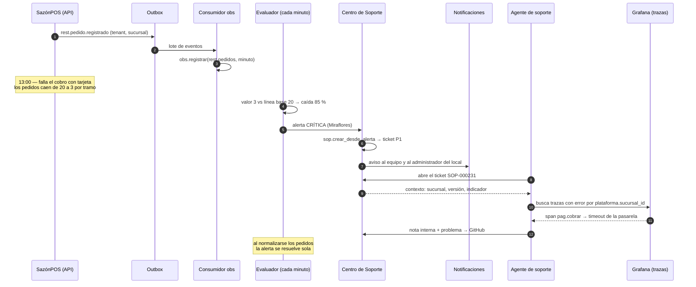

## OP-04 — ¿Se puede compartir este dato de persona entre sistemas?

Árbol de decisión que aplica el principio de finalidad de la Ley 29733 a la idea de consulta intersistémica. Solo dos caminos son legítimos sin pedir permiso a la persona: datos que vienen de una fuente pública autorizada (nivel 1) y datos dentro del mismo cliente con finalidad declarada (nivel 2). Entre clientes distintos, solo con el consentimiento del titular (nivel 3).

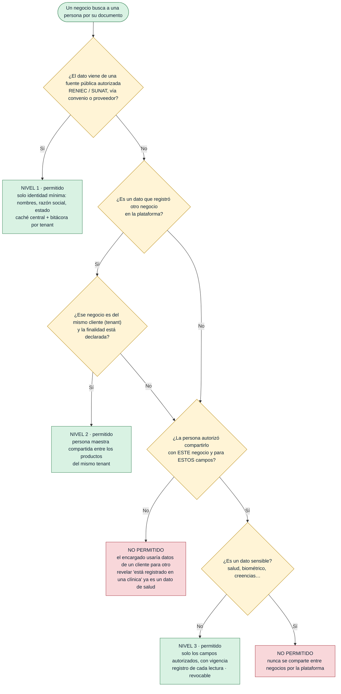

## OP-05 — Identidad en tres niveles

Reformulación de la idea "tipo PIDE intersistémico". La clínica y el gimnasio nunca se comunican entre sí: cada uno consulta la fuente pública (nivel 1) y, si la persona tiene una cuenta de plataforma, le pide autorización para recibir sus datos de contacto (nivel 3). La cuenta del titular es de la plataforma, no de un negocio.

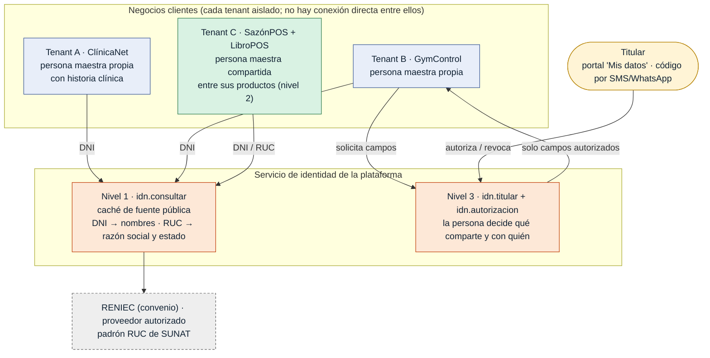

## OP-06 — Secuencia: consulta de DNI o RUC (nivel 1)

El servicio de identidad valida el formato (incluido el dígito verificador del RUC) antes de gastar una consulta, responde desde la caché si está vigente y, si no, reserva cuota y llama al proveedor principal con respaldo. Cada consulta queda en la bitácora del tenant con el número en hash.

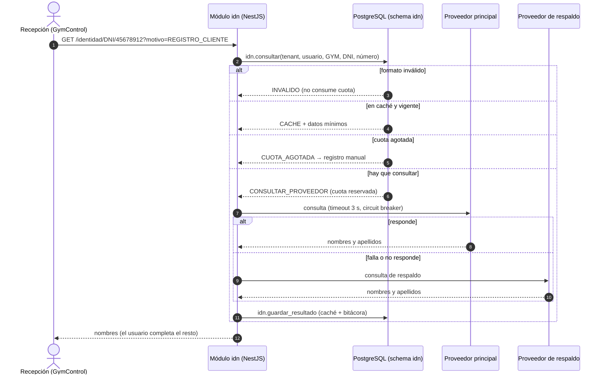

## OP-07 — Secuencia: autorización del titular (nivel 3)

El gimnasio pide campos concretos con una finalidad. El código de un solo uso llega a la persona, nunca al negocio. Al confirmar, el gimnasio recibe solo lo autorizado; cada lectura queda registrada y la persona puede revocar desde su portal. La respuesta al negocio es la misma exista o no la cuenta, para no revelar quién está registrado. Es la aplicación práctica del derecho de portabilidad que incorpora el reglamento vigente de la Ley 29733.

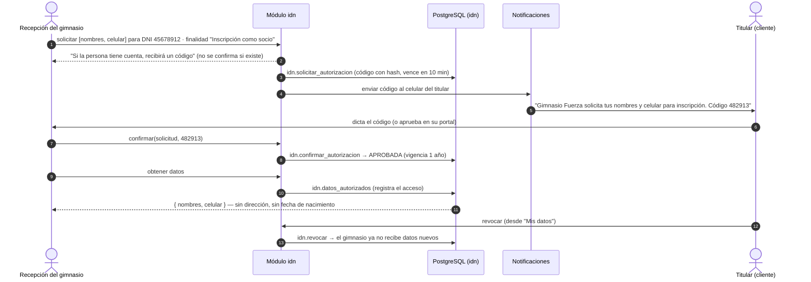

## OP-08 — Módulo de identidad en arquitectura hexagonal

El dominio no conoce a RENIEC ni a ningún proveedor: depende del puerto ProveedorIdentidad. Cada proveedor es un adaptador intercambiable; cambiar de proveedor o agregar uno de respaldo no toca los casos de uso. Sigue la misma estructura de la Guía de Arquitectura de Código Backend.

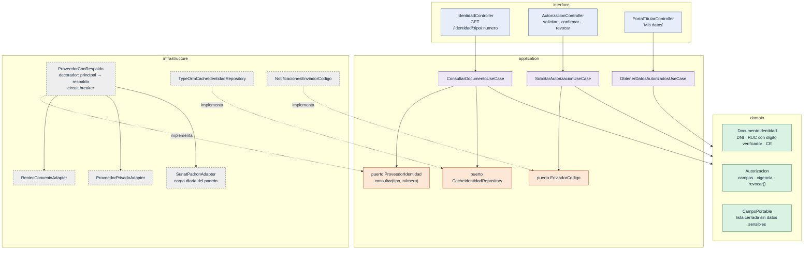

## OP-09 — Modelo de datos del servicio de identidad (schema idn)

La caché y el titular son globales (sin tenant) y solo se acceden por funciones; la bitácora, las solicitudes y las autorizaciones llevan tenant y RLS. Las restricciones CHECK impiden guardar en caché más que la identidad mínima y en la identidad portable cualquier dato sensible.

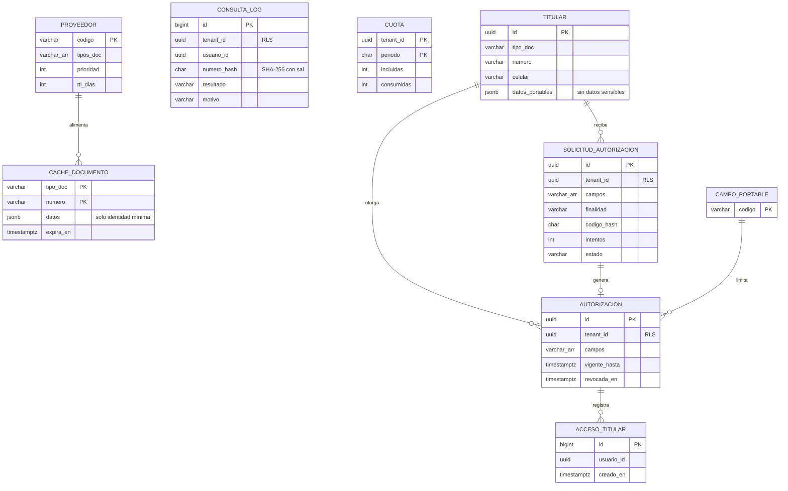

## OP-10 — Proceso de atención de incidencias

Proceso con cuatro carriles. El primer nivel (N1, funcional) lo puede atender el socio comercial con la base de conocimiento; el segundo nivel (N2, técnico) lo atiende el desarrollador con la traza a mano. Las causas comunes se agrupan en un problema que vive en GitHub, y al publicarse la corrección se resuelven todos los tickets enlazados.

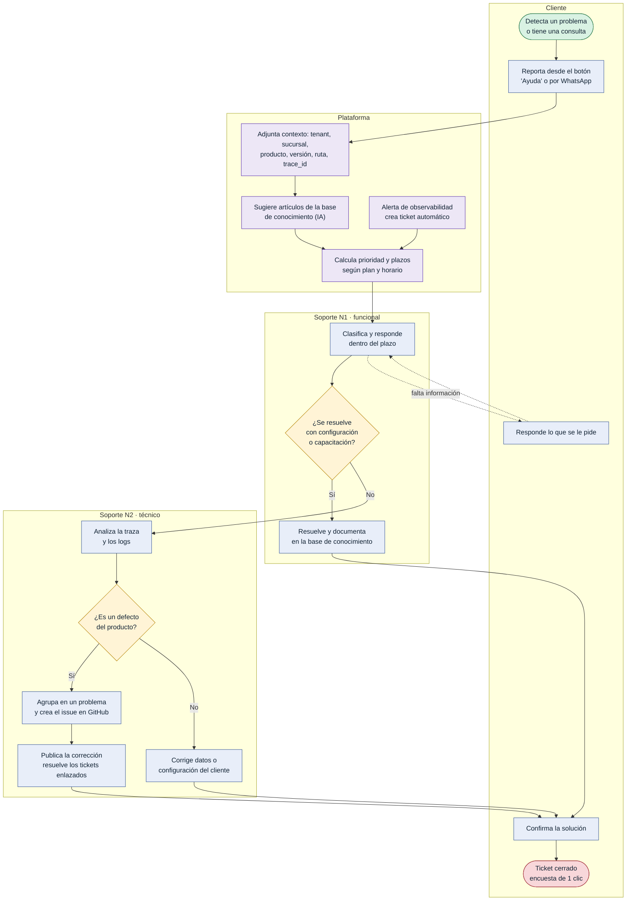

## OP-11 — Ciclo de vida del ticket

Estados y transiciones validados en la base de datos (tabla sop.transicion). Mientras el ticket espera al cliente el plazo se pausa; al escalar pasa a nivel N2; un ticket resuelto puede reabrirse dentro de su ventana de confirmación.

```mermaid
stateDiagram-v2
  [*] --> NUEVO
  NUEVO --> EN_ANALISIS : primera respuesta
  NUEVO --> RESUELTO : resuelto con artículo
  EN_ANALISIS --> ESPERA_CLIENTE : se pide información (SLA en pausa)
  ESPERA_CLIENTE --> EN_ANALISIS : el cliente responde
  ESPERA_CLIENTE --> CERRADO : sin respuesta en 5 días
  EN_ANALISIS --> ESCALADO_N2 : requiere análisis técnico
  ESCALADO_N2 --> EN_ANALISIS : vuelve a N1
  ESCALADO_N2 --> RESUELTO : corrección publicada
  EN_ANALISIS --> RESUELTO
  RESUELTO --> CERRADO : el cliente confirma o pasan 3 días
  RESUELTO --> REABIERTO : el cliente rechaza
  REABIERTO --> EN_ANALISIS
  CERRADO --> [*]
```

## OP-12 — Modelo de datos del Centro de Soporte y de la observabilidad de negocio

Los tickets llevan tenant, empresa y sucursal del modelo organizacional, el plan contratado (para los plazos) y, opcionalmente, la alerta que los originó y el problema al que pertenecen. Las notas internas nunca son visibles al cliente (CHECK y política RLS).

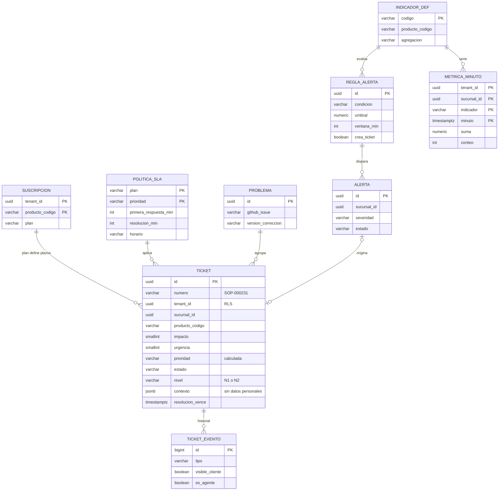

## OP-13 — Hoja de ruta de la plataforma de operación

Secuencia alineada con la prioridad de productos. Las fechas son relativas al lanzamiento de SazónPOS y suponen dedicación a tiempo parcial; lo importante es el orden y los disparadores, no el calendario exacto.

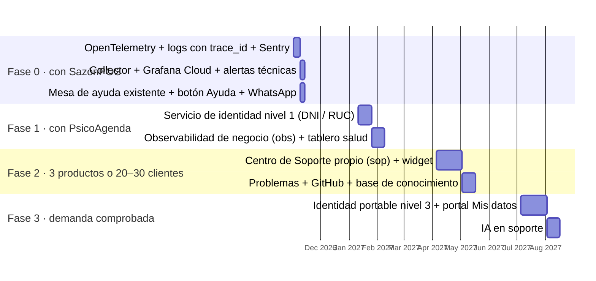
