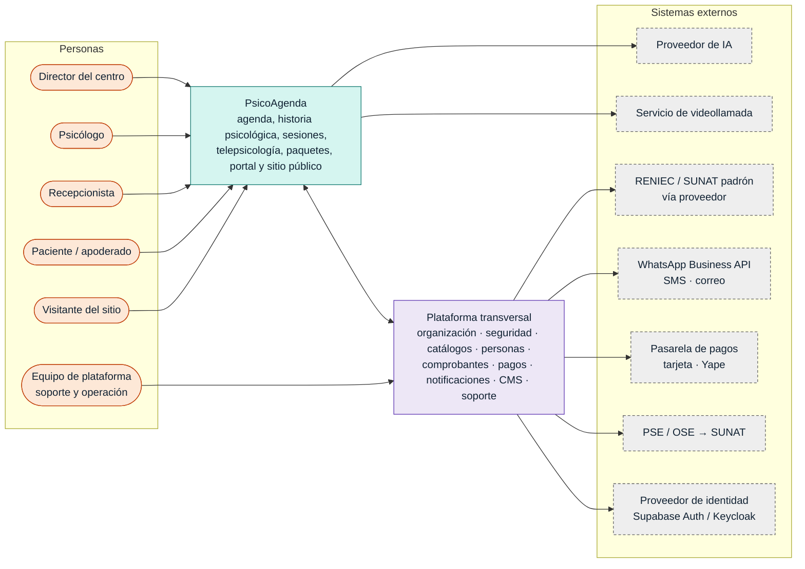
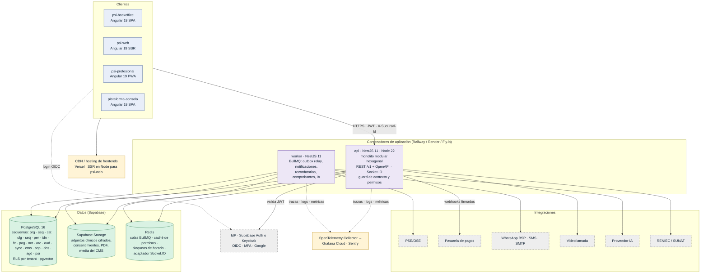
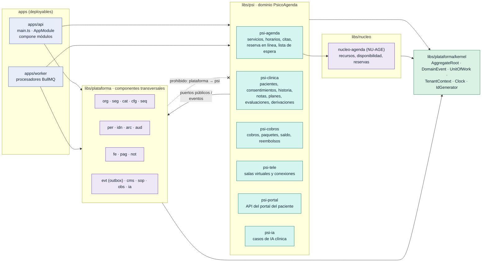
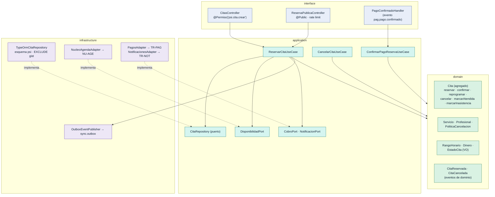
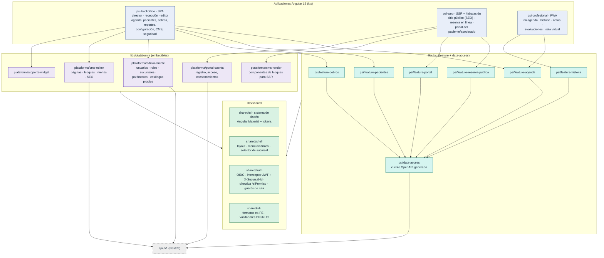
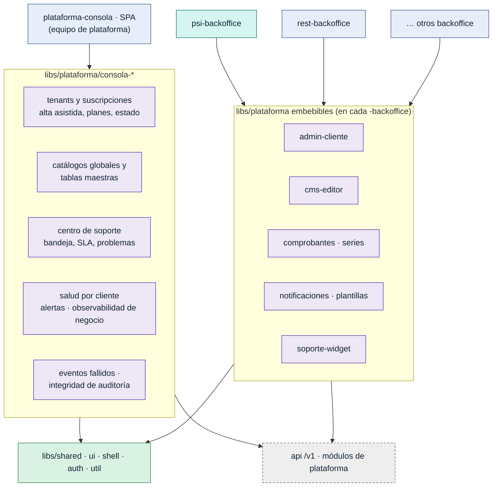
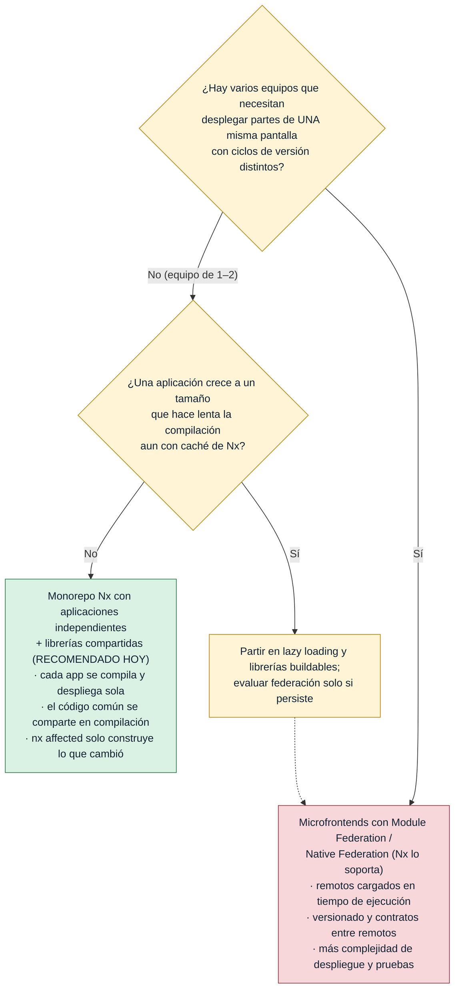
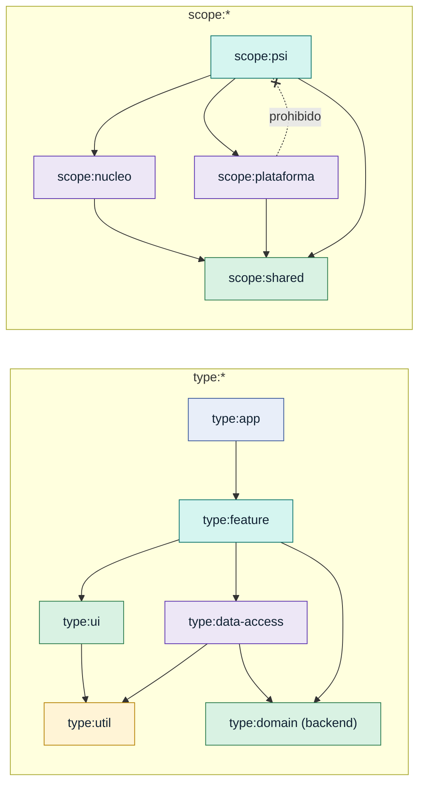
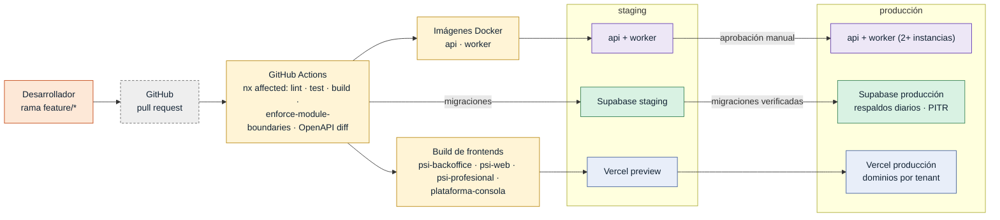

# 1 Arquitectura

## A-01 — Contexto del sistema (C4 nivel 1)

PsicoAgenda y la plataforma transversal en su entorno: quiénes los usan y con qué sistemas externos se integran. La plataforma provee identidad, organización, cobros, comprobantes, notificaciones y contenidos; PsicoAgenda aporta el dominio clínico y de agenda.

## A-02 — Arquitectura backend y stack tecnológico

Contenedores del sistema. Los frontends Angular se publican en un CDN; la API es un monolito modular NestJS que contiene los módulos de plataforma y los de PsicoAgenda; un worker separado procesa colas (outbox, notificaciones, recordatorios, comprobantes, IA). PostgreSQL de Supabase con un esquema por módulo y RLS por tenant; Redis para colas, caché de permisos y Socket.IO.

## A-03 — Backend: módulos del monolito y reglas de dependencia

Dentro de la API, cada módulo es una librería Nx con arquitectura hexagonal (dominio, aplicación, infraestructura, interfaz). Los módulos de PsicoAgenda dependen de los de plataforma solo a través de sus puertos públicos (API de aplicación o eventos), nunca de sus tablas. Las reglas se verifican con enforce-module-boundaries en CI.

## A-04 — Backend: capas hexagonales de un módulo (psi-agenda)

Estructura interna de un módulo de PsicoAgenda. El dominio no depende de NestJS ni de TypeORM. Los casos de uso orquestan agregados y usan puertos; la infraestructura implementa los puertos (repositorios TypeORM, adaptadores a plataforma) y la interfaz expone controladores y consumidores de eventos.

## A-05 — Frontend de PsicoAgenda: aplicaciones y librerías

Tres aplicaciones Angular del monorepo, cada una compilada y desplegada por separado, que comparten librerías: el sistema de diseño, el shell autenticado, la seguridad cliente, el acceso a datos generado desde OpenAPI y los módulos de administración de plataforma que se embeben en el backoffice.

## A-06 — Frontend de la plataforma transversal

La consola de plataforma es la aplicación del equipo dueño del producto (tenants, suscripciones, catálogos globales, soporte, observabilidad). La administración que usa cada cliente no es una aplicación aparte: son librerías que se embeben en el backoffice de cada producto, para que el cliente no cambie de sistema.

## A-07 — ¿Monorepo o microfrontends?

Un monorepo no implica microfrontends. Monorepo es dónde vive el código (un solo repositorio con muchas aplicaciones y librerías); microfrontends es cómo se compone la interfaz en tiempo de ejecución (varias aplicaciones desplegadas por separado que se cargan dentro de otra). Para un equipo de una o dos personas se recomienda monorepo con aplicaciones independientes y librerías compartidas, sin federación en tiempo de ejecución.

## A-08 — Reglas de dependencia entre proyectos del monorepo

Etiquetas de Nx que controla enforce-module-boundaries: por tipo (app → feature → ui / data-access → util) y por alcance (psi solo usa psi, nucleo, plataforma y shared; plataforma nunca usa psi). Así el piloto deja lista la base que reutilizarán los otros ocho productos.

## A-09 — Despliegue y entornos

Tres entornos con la misma topología. GitHub Actions ejecuta nx affected (lint, pruebas, build, límites de módulos), publica las imágenes de api y worker y despliega los frontends. Las migraciones de base de datos se aplican en el pipeline con verificación previa en staging.

