# 2 Plataforma Transversal

## T-01 — Plataforma: mapa de contextos acotados

Contextos acotados de la plataforma y sus relaciones. Organización y Seguridad son el núcleo del que dependen todos (aguas arriba). Personas, Catálogos, Parámetros y Correlativos son servicios de referencia. Comprobantes, Pagos, Notificaciones, Archivos y CMS son servicios de soporte consumidos por los productos mediante puertos (capa anticorrupción en cada producto). Eventos (outbox) conecta a todos de forma asíncrona.

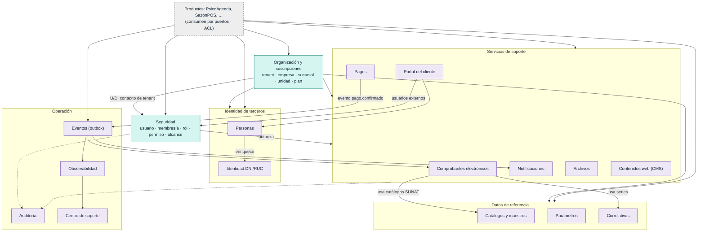

## T-02 — Modelo de dominio · Organización y suscripciones

Un tenant (cliente que contrata) agrupa una o más empresas con RUC; cada empresa tiene uno o más establecimientos (sucursales) y estos sus unidades operativas. El almacén central es la única unidad que puede pertenecer a la empresa sin sucursal. La suscripción habilita productos y fija límites.

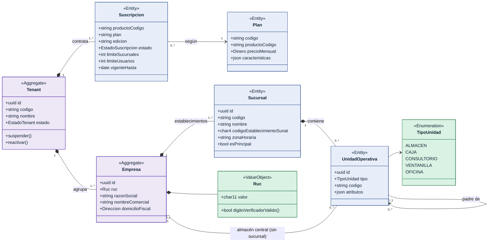

## T-03 — Modelo de dominio · Seguridad

La identidad (credenciales, MFA, OAuth) la resuelve el IdP; la plataforma guarda la autorización. Un usuario tiene una membresía por tenant; cada membresía tiene asignaciones de un rol o de un perfil con un alcance (tenant, empresa, sucursal o unidad) y vigencia. Los roles agrupan permisos de un producto; los perfiles agrupan roles de varios productos. Las opciones de menú exigen permisos.

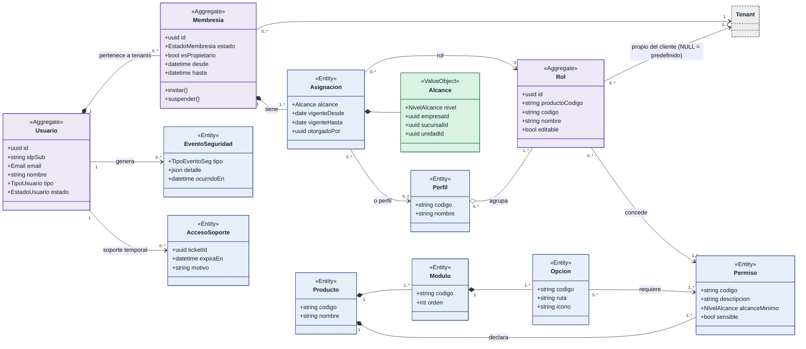

## T-04 — Modelo de dominio · Catálogos, parámetros y correlativos

Un catálogo tiene ítems globales (tenant nulo) y propios de un tenant; el tenant puede ajustar un ítem global (alias, orden, visibilidad). Los parámetros tienen una definición y valores por nivel; el valor efectivo es el más específico. Las series correlativas se definen por empresa, tipo y serie, con alcance opcional de sucursal o unidad y regla de reinicio.

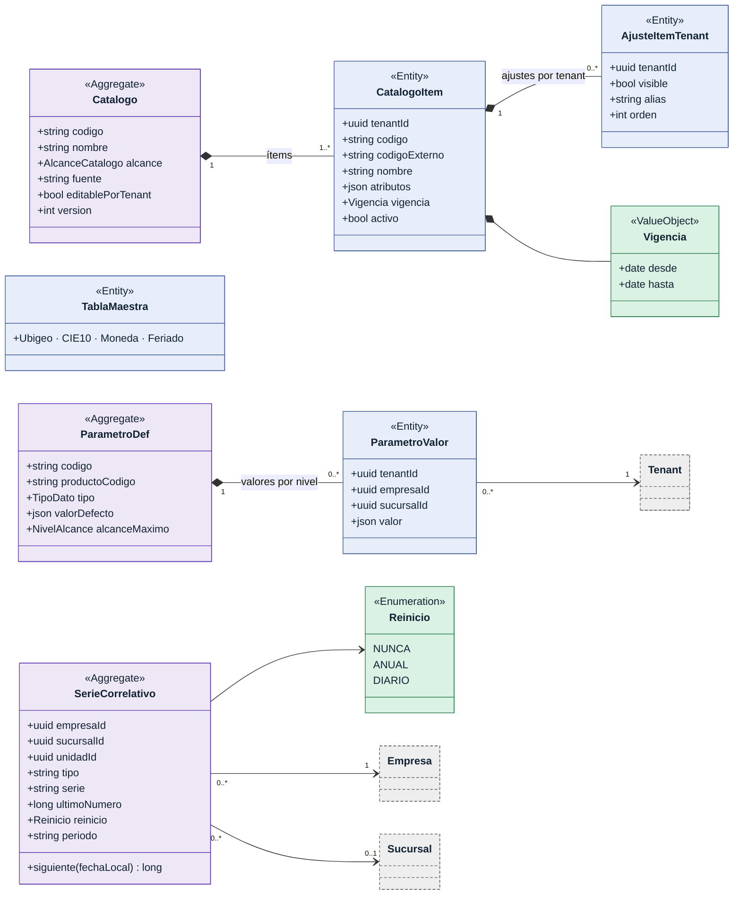

## T-05 — Modelo de dominio · Personas e identidad

La persona pertenece a un tenant (titular del banco de datos) y es natural o jurídica, con documentos, contactos, direcciones con ubigeo y consentimientos versionados. La caché de identidad es global y solo guarda la identidad mínima de la fuente; la identidad portable pertenece al titular, que autoriza campos a un tenant.

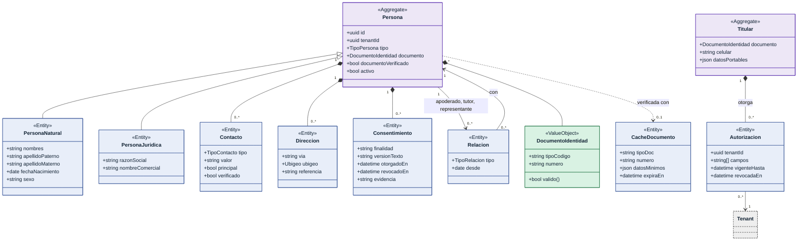

## T-06 — Modelo de dominio · Comprobantes electrónicos y pagos

Un cobro de un producto genera una intención de pago en la plataforma; la pasarela confirma una o más transacciones (incluye reembolsos). Un comprobante pertenece a una empresa y a una serie del establecimiento, tiene ítems con afectación de IGV y una o más gestiones de envío al PSE/OSE con su respuesta (CDR). Las notas de crédito referencian el comprobante original.

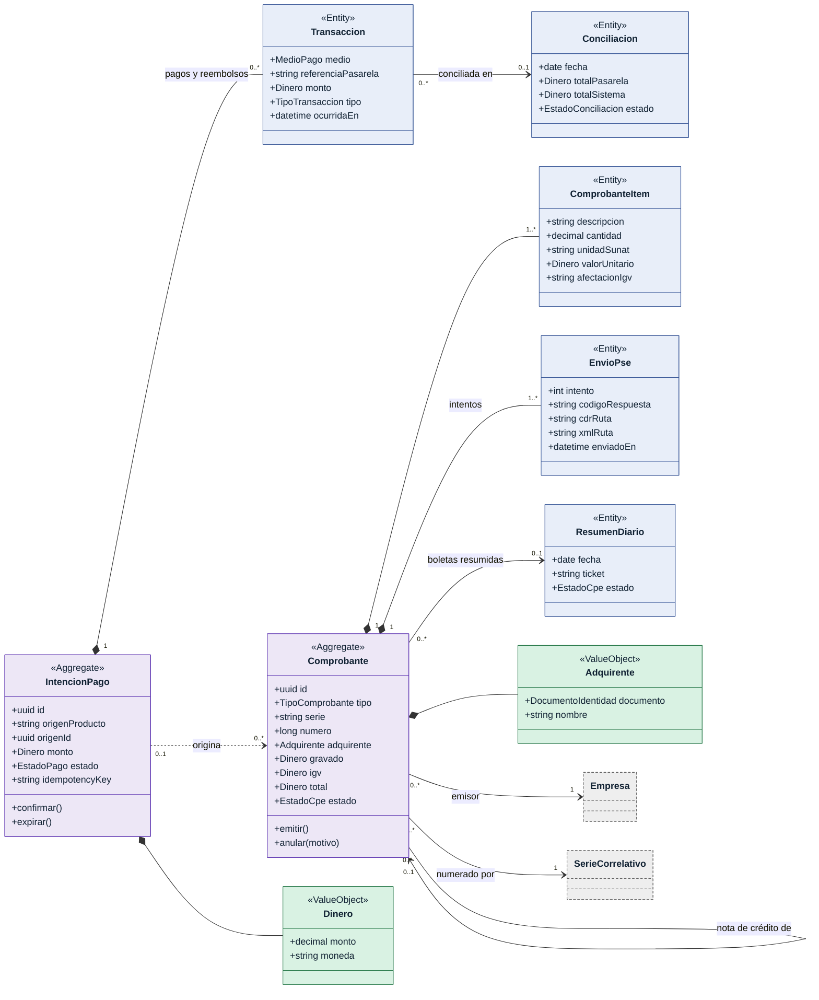

## T-07 — Modelo de dominio · Notificaciones, archivos, auditoría y eventos

Servicios de soporte de uso general. Una plantilla por canal genera mensajes con intentos de entrega y respeta las preferencias del destinatario. Los archivos tienen versiones con hash. La auditoría es inmutable y el outbox guarda cada evento de dominio con su avance por suscriptor.

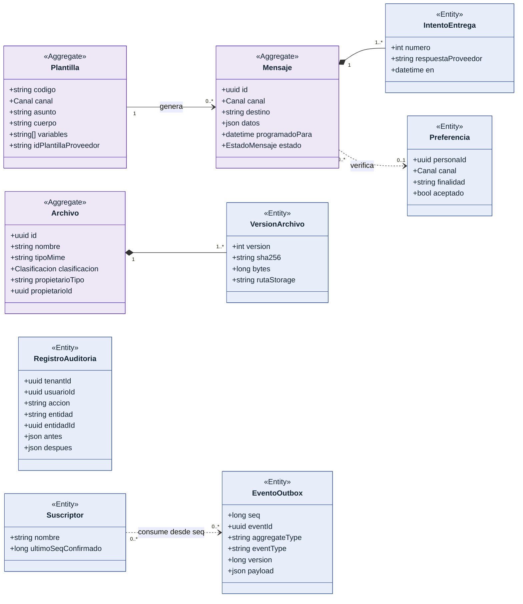

## T-08 — Modelo de dominio · Contenidos web (CMS) y portal del cliente

Cada tenant puede tener un sitio por producto con dominio propio o subdominio y su marca. El sitio tiene páginas con versiones (borrador/publicada) compuestas por bloques ordenados, menús, artículos y medios. La cuenta de cliente del portal es un usuario externo de Seguridad enlazado a una Persona del tenant.

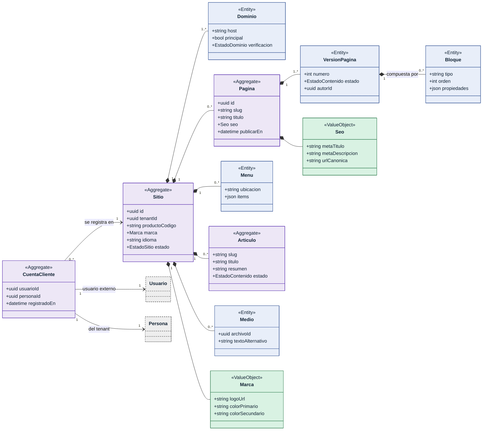

## T-09 — Modelo de dominio · Centro de soporte y observabilidad

Modelo de la Plataforma de Operación: los tickets toman los plazos del plan contratado y pueden nacer de una alerta; varios tickets se agrupan en un problema enlazado al backlog. Los indicadores de negocio alimentan reglas que abren alertas deduplicadas por sucursal.

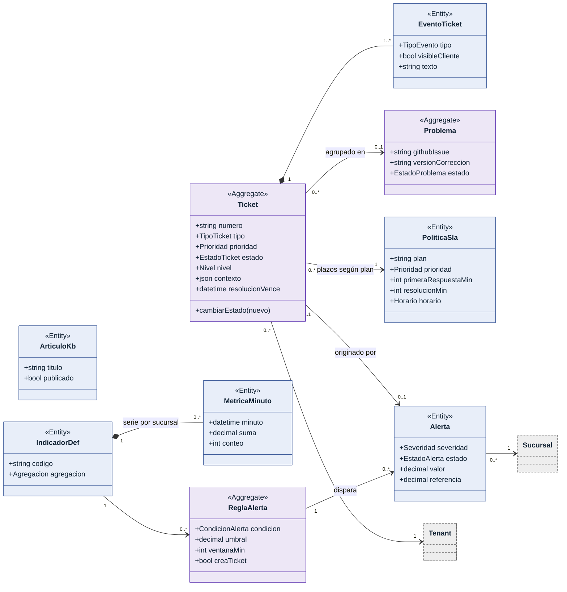

## T-S1 — Secuencia · Alta de un nuevo cliente (tenant)

Alta asistida desde la consola de plataforma: valida el RUC, crea tenant, empresa, sucursal principal y suscripción, siembra roles y parámetros por defecto e invita al administrador del cliente, todo en una transacción con eventos al outbox.

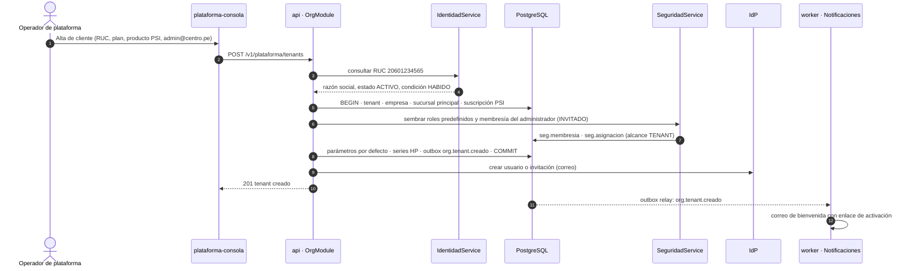

## T-S2 — Secuencia · Inicio de sesión, sucursal activa y autorización

El IdP autentica; la plataforma decide qué puede hacer el usuario. Tras el login, el shell consulta las sucursales accesibles; si hay más de una, el usuario elige. Cada solicitud lleva JWT y X-Sucursal-Id; el guard resuelve permisos efectivos (con caché versionada) y publica el contexto que usan RLS y la auditoría.

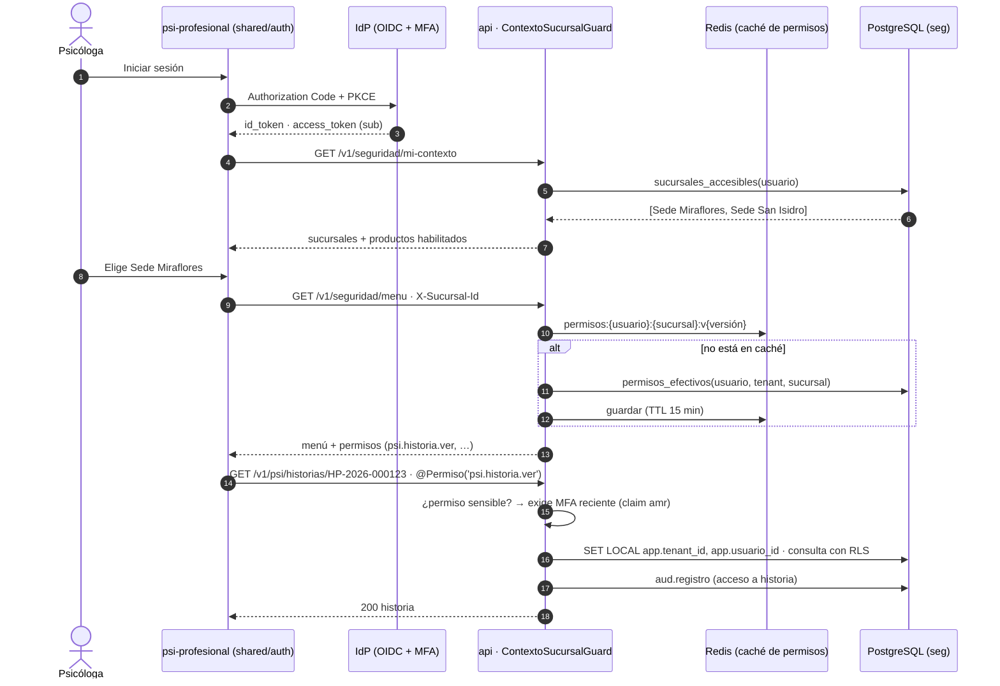

## T-S3 — Secuencia · Emisión de comprobante electrónico

El producto no conoce al PSE/OSE: publica el evento de cobro confirmado y el componente de comprobantes toma la serie del establecimiento, arma el documento con catálogos SUNAT y la tasa de IGV de la empresa, lo envía con reintentos y notifica el resultado.

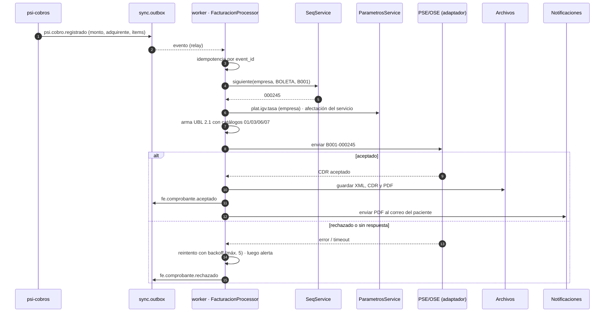

## T-S4 — Secuencia · Pago en línea con confirmación por webhook

La intención de pago se crea con clave de idempotencia; el paciente paga en la pasarela y la confirmación llega por webhook firmado. La plataforma verifica la firma, registra la transacción y publica el evento que consume el producto (no confía en la redirección del navegador).

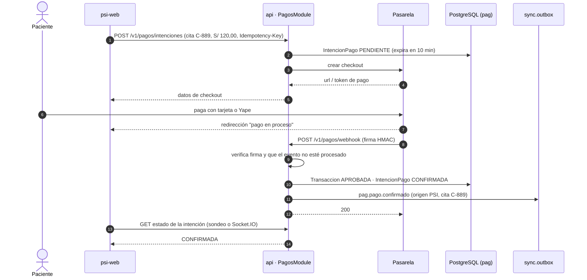

## T-S5 — Secuencia · Recordatorio programado con preferencias del paciente

Los recordatorios se programan como trabajos diferidos; al ejecutarse se vuelve a verificar que la cita siga vigente y que el paciente acepte ese canal. El mensaje solo lleva datos administrativos.

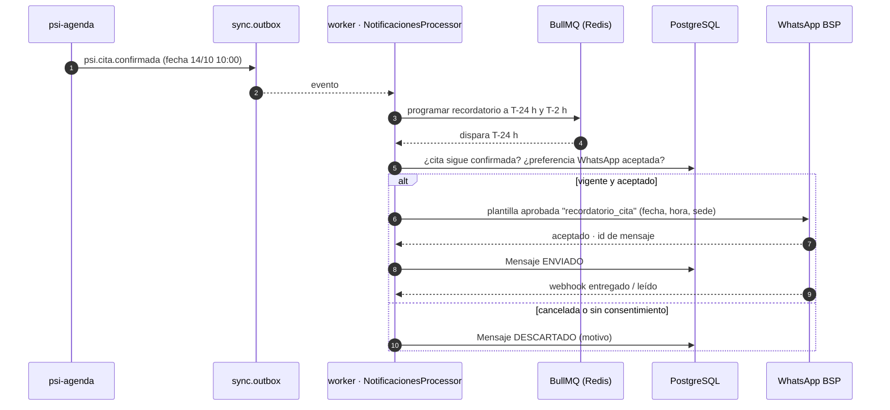

## T-S6 — Secuencia · Publicación de contenido y render SSR del sitio

El editor arma la página con bloques en el backoffice; al publicar se congela una versión y se invalida la caché del CDN. La aplicación pública resuelve el tenant por el dominio y renderiza en servidor los bloques con la librería cms-render.

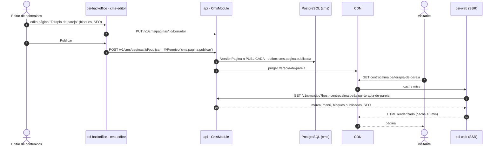

## T-S7 — Secuencia · Relay del outbox hacia los consumidores

El cambio de estado y su evento se guardan en la misma transacción. El relay del worker lee por cursor con margen de seguridad, entrega a las colas de cada consumidor y avanza el cursor; los consumidores son idempotentes por event_id.

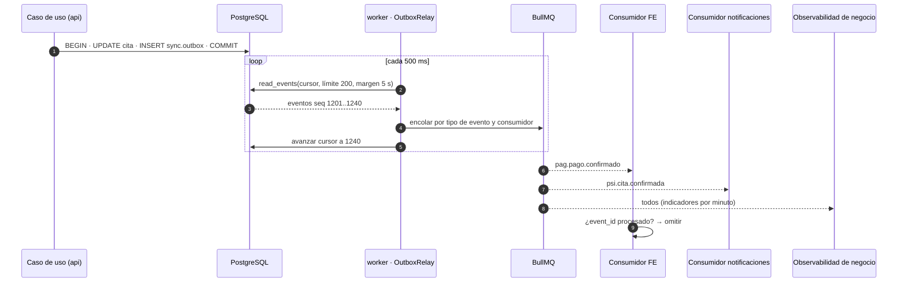
