# 3 PsicoAgenda

## P-01 — PsicoAgenda: mapa de contextos acotados

PsicoAgenda se divide en cinco contextos. Agenda se apoya en el núcleo NU-AGE (compartido con TurnoFácil, GymControl, ClínicaNet y JurisFlujo). Clínica es el corazón y el único contexto con datos de salud: los demás solo conocen identificadores. Cobros, Portal y Contenidos consumen servicios de la plataforma mediante adaptadores.

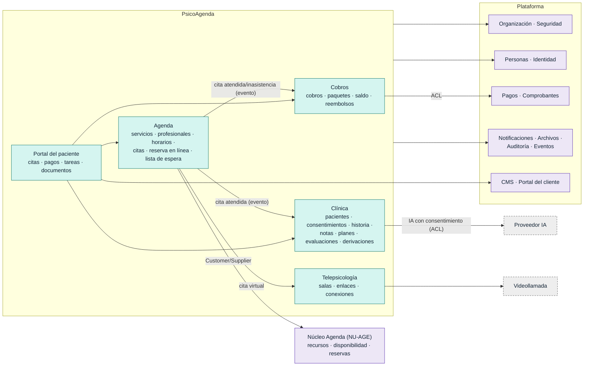

## P-02 — Modelo de dominio · Agenda

El profesional (un usuario del tenant con colegiatura) atiende servicios en sedes y consultorios según horarios semanales y excepciones. La cita es el agregado central: reserva un rango del profesional y, si es presencial, de un consultorio; puede venir de una reserva en línea con bloqueo temporal y alimentar la lista de espera al liberarse.

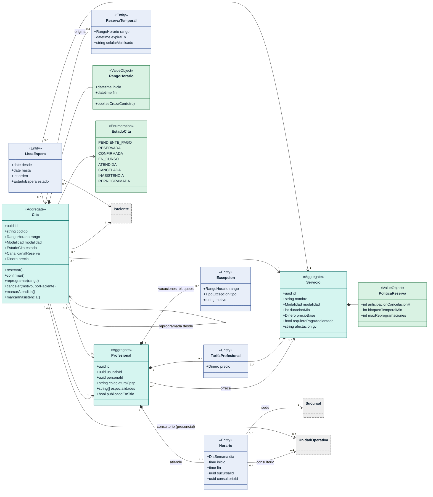

## P-03 — Modelo de dominio · Clínica (historia psicológica)

El paciente es una Persona del tenant con datos clínicos en PsicoAgenda; si es menor, tiene uno o más apoderados. La historia psicológica (una por paciente y empresa, numerada HP-AAAA-NNNNNN) agrupa anamnesis, impresiones diagnósticas CIE-10, notas de sesión firmadas e inmutables con adendas, planes de tratamiento, evaluaciones con plantillas versionadas y derivaciones. El acceso lo concede el profesional tratante y cada lectura se audita.

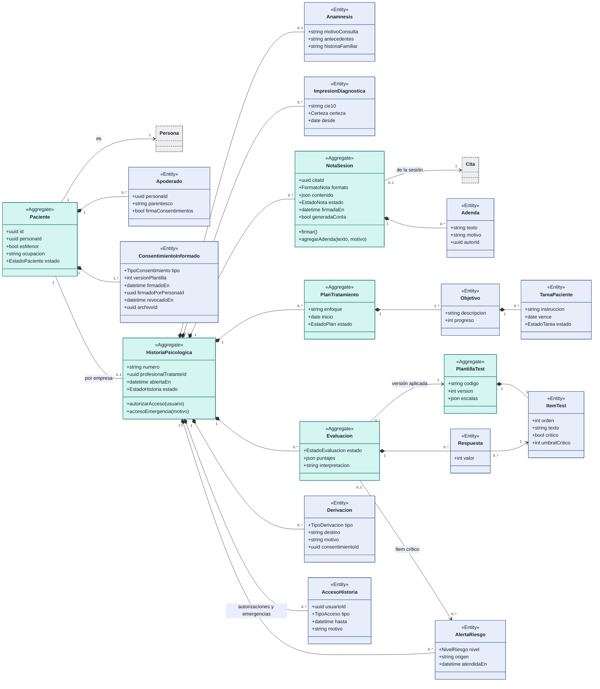

## P-04 — Modelo de dominio · Cobros, paquetes y telepsicología

Un cobro corresponde a una cita o a la compra de un paquete y se salda con una intención de pago de la plataforma (en línea) o con pagos en caja; genera un comprobante electrónico o, para psicólogos independientes, el registro del recibo por honorarios emitido en SUNAT. El paquete lleva el saldo de sesiones con sus consumos. Una cita virtual tiene una sala con un enlace único por participante y su registro de conexiones.

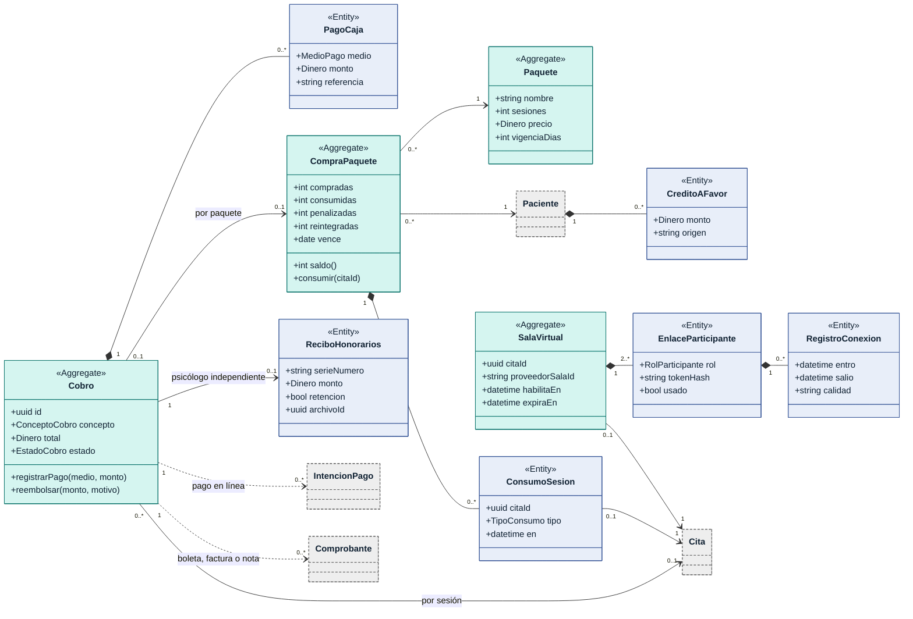

## P-05 — Estados de la cita

Ciclo de vida del agregado Cita con las reglas de negocio que gobiernan cada transición (PSI-RN-005, 007, 008, 013, 036).

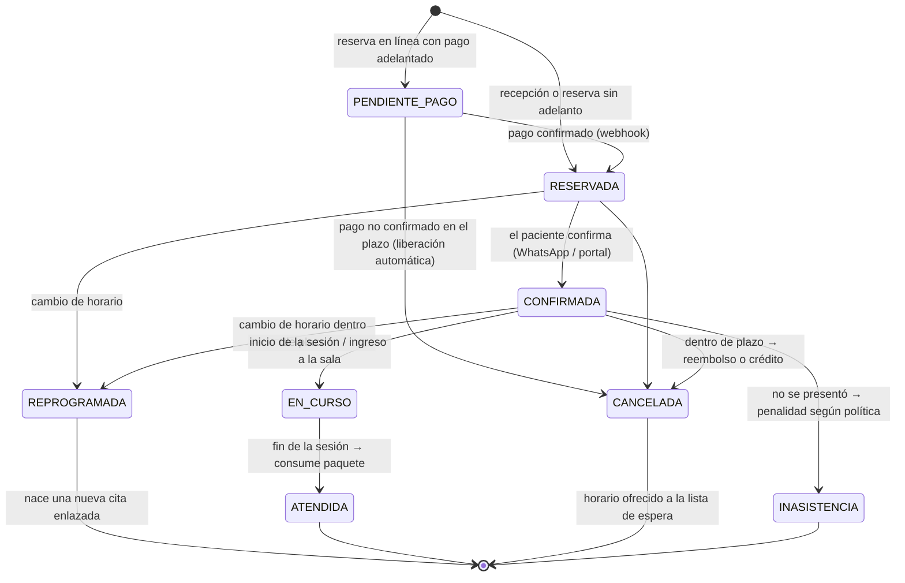

## P-06 — Estados de la nota de sesión

La nota pasa de borrador a firmada; una vez firmada es inmutable y solo admite adendas (PSI-RN-011). Si no se firma en 72 horas se marca como atrasada (PSI-RN-012). El borrador generado con IA se identifica como tal y requiere revisión del profesional (PSI-RN-022).

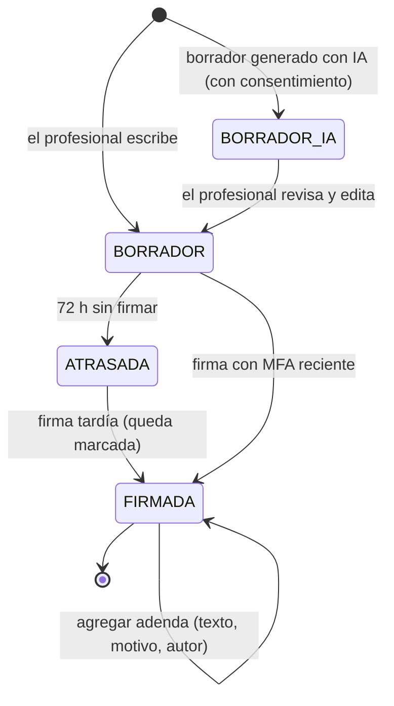

## P-S1 — Secuencia · Reserva en línea con pago adelantado

El paciente reserva desde el sitio público: el horario se bloquea temporalmente en Redis y en la base (restricción de exclusión), se verifica el celular, se crea la cita en PENDIENTE_PAGO y se cobra con la plataforma. La confirmación llega por evento del webhook; si el pago no llega a tiempo, un trabajo libera el horario.

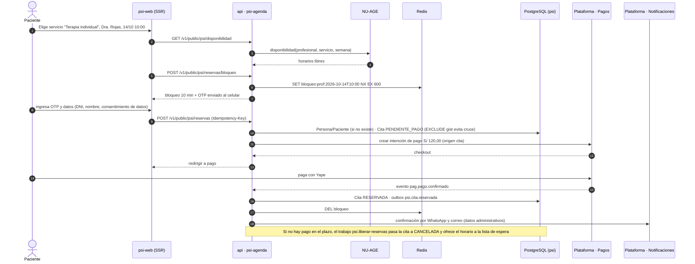

## P-S2 — Secuencia · Admisión y apertura de historia psicológica

En la primera sesión, recepción registra al paciente (con consulta de DNI) y su apoderado si es menor; el paciente firma los consentimientos vigentes y el profesional abre la historia con número correlativo de la empresa. Sin consentimiento firmado no se abre historia.

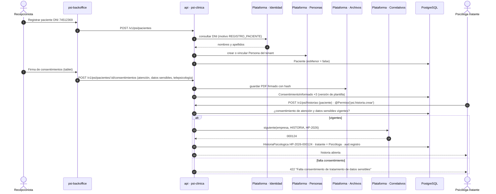

## P-S3 — Secuencia · Sesión virtual, nota y firma

La sala se habilita 15 minutos antes con enlaces únicos por participante. Al terminar, la cita pasa a ATENDIDA (consume paquete) y el profesional escribe o revisa la nota; la firma exige MFA reciente y vuelve la nota inmutable.

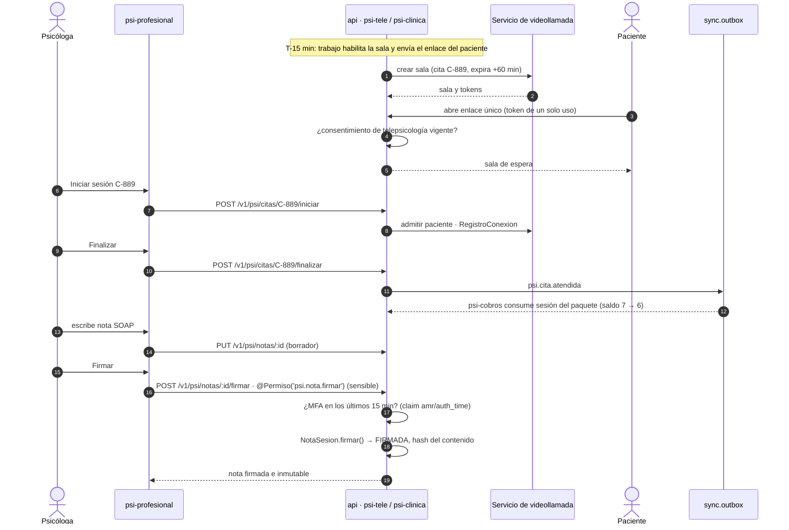

## P-S4 — Secuencia · Venta de paquete en caja y comprobante

La recepcionista vende un paquete de 8 sesiones. El cobro se registra en PsicoAgenda; el comprobante lo emite la plataforma a partir del evento. Si el centro es un psicólogo independiente, en lugar del comprobante se registra el recibo por honorarios emitido en SUNAT.

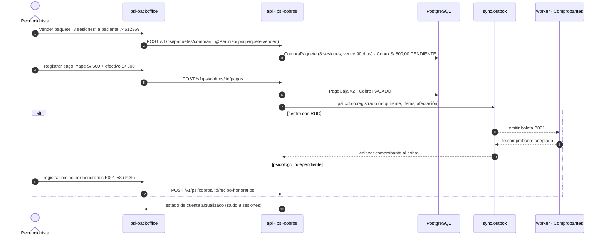

## P-S5 — Secuencia · Evaluación en línea con ítem crítico

El profesional asigna un test al paciente, que lo responde en el portal. La calificación usa la versión de plantilla vigente al aplicarla; un ítem crítico en el umbral genera una alerta solo para el profesional tratante, sin mensajes automáticos al paciente (PSI-RN-024, 033, 034).

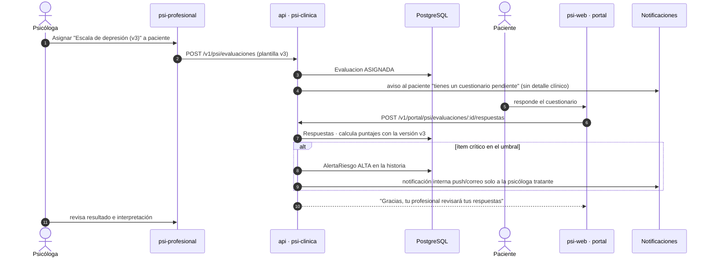

## P-S6 — Secuencia · Acceso de emergencia a una historia

Un profesional sin autorización necesita leer una historia (por ejemplo, reemplazo urgente). Solo el director puede activar el acceso de emergencia, con motivo y vigencia limitada; queda auditado y el tratante recibe aviso (PSI-RN-002, 040).

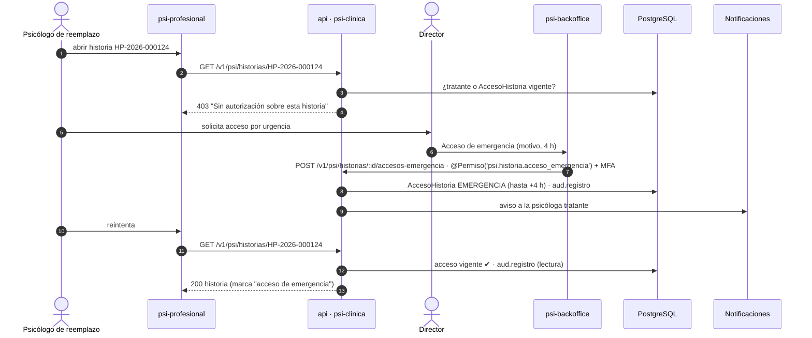

## P-S7 — Secuencia · Cancelación por el paciente, reembolso y lista de espera

El paciente cancela desde el portal. Dentro del plazo de anticipación se reembolsa al medio original o se da crédito a favor; el horario liberado se ofrece al primero de la lista de espera, que tiene 30 minutos para aceptar (PSI-RN-007, 032, 036).

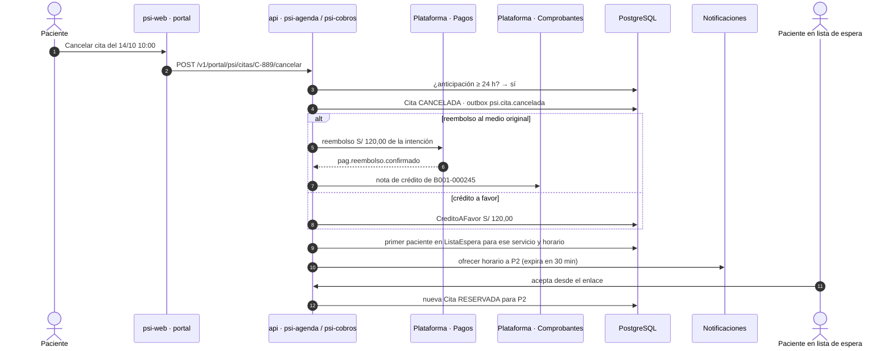
