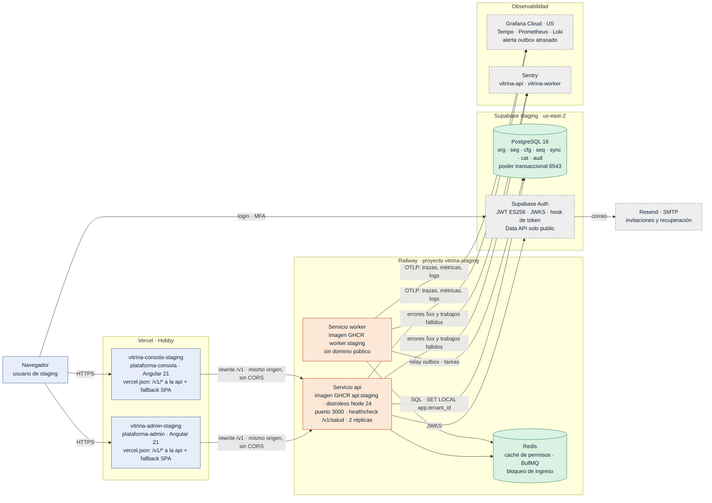
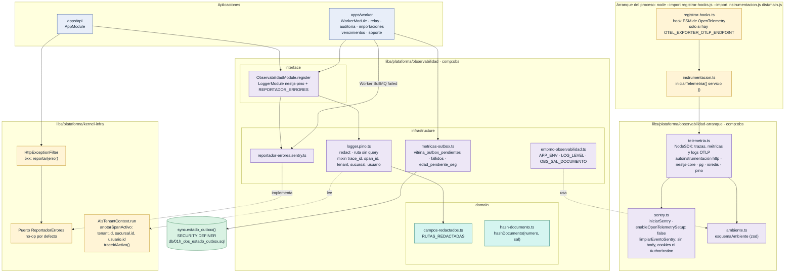
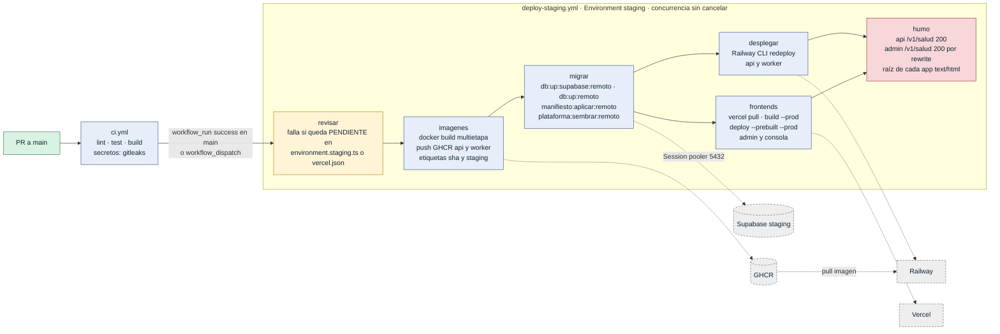

# Diagramas de staging y observabilidad (spec 21)

Fuente: `specs/21-obs-y-staging.md`, `docs/ops/staging.md`, `.github/workflows/deploy-staging.yml`. Cada diagrama tiene su `.mmd` en esta carpeta.

## ST-01 — Despliegue de staging (spec 21 · E-04)

## ST-02 — Componentes de observabilidad en api y worker (spec 21 · E-03)

## ST-03 — Pipeline de entrega a staging (deploy-staging.yml · spec 21)

## ST-04 — Secuencia: solicitud trazada de punta a punta en staging (spec 21)

```mermaid
sequenceDiagram
  autonumber
  actor U as Usuario
  participant V as Vercel (admin)
  participant A as api (Railway)
  participant R as Redis
  participant P as PostgreSQL (Supabase)
  participant G as Grafana Cloud
  participant S as Sentry

  U->>V: GET /v1/seg/roles + Bearer
  V->>A: rewrite a https://api…railway.app/v1/seg/roles
  Note over A: autoinstrumentación http abre el span raíz<br/>AlsTenantContext.run anota tenant.id, sucursal.id, usuario.id
  A->>R: get permisos efectivos (span ioredis)
  R-->>A: hit o miss
  A->>P: START · SET LOCAL app.tenant_id · SELECT · COMMIT (spans pg)
  P-->>A: filas
  A-->>V: 200 JSON
  V-->>U: 200
  A--)G: span y métricas http_server_request_duration por OTLP
  A--)G: log pino "request completed" con trace_id (Loki)
  alt error 5xx
    A->>A: HttpExceptionFilter llama ReportadorErrores.reportar
    A--)S: issue con environment=staging y trace_id, sin body, cookies ni Authorization
  end

  Note over G: Worker: cada lectura de sync.estado_outbox() publica<br/>vitrina_outbox_edad_pendiente_seg. Alerta si > 60 s por 5 min o sin datos
```

